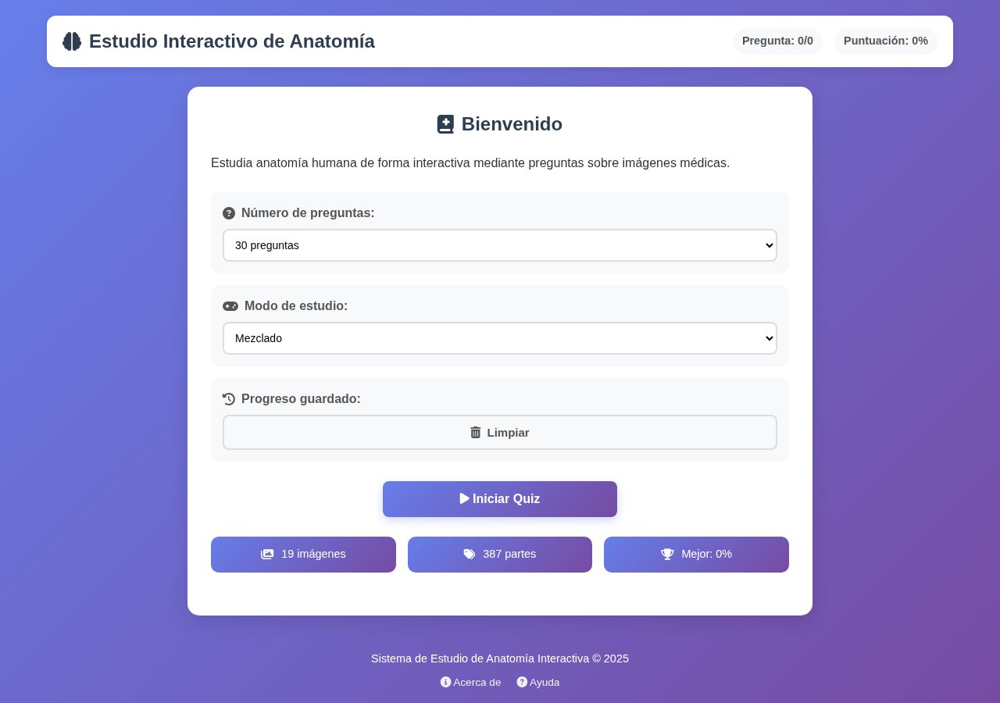
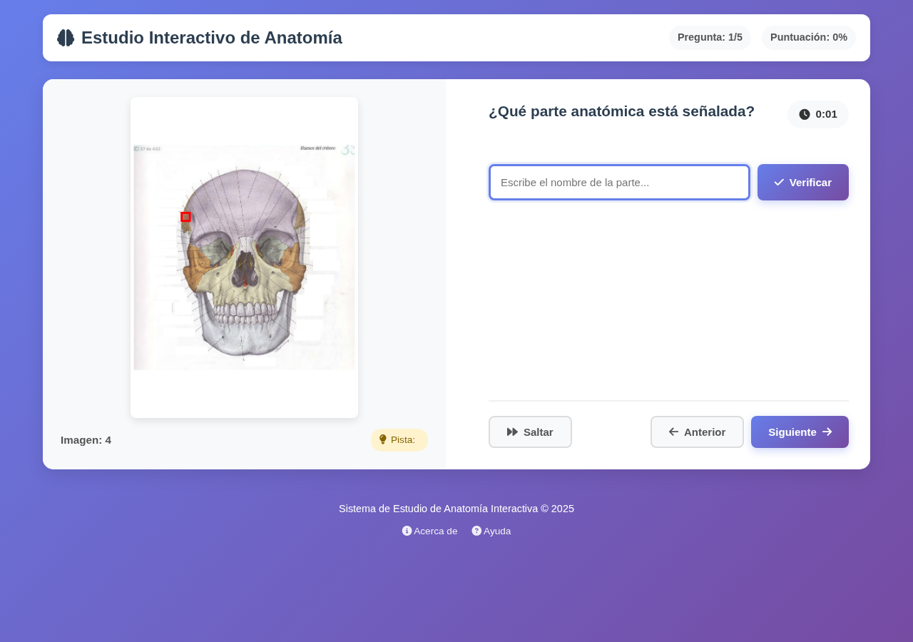

# Anatomy Page · Estudio interactivo de anatomía

Web de estudio para memorizar anatomía humana. Se muestra una lámina anatómica con un **recuadro rojo** sobre una estructura y hay que **escribir su nombre**. Es una página estática (HTML + CSS + JavaScript puro): no necesita servidor propio, base de datos ni dependencias que instalar.



## Qué hace

- Genera un cuestionario de 5 a 120 preguntas a partir de las láminas de `images/sin_nombres/`.
- Marca sobre la imagen la zona que hay que identificar (un `<canvas>` superpuesto dibuja el cuadro rojo).
- Corrige la respuesta ignorando mayúsculas, tildes y signos (`"Ángulo Esfenoidal"` = `"angulo esfenoidal"`).
- Si fallas, enseña la respuesta correcta y **hasta tres sugerencias** de nombres parecidos.
- Al terminar muestra nota, aciertos, fallos, saltadas, tiempo, preguntas por minuto y el detalle de cada respuesta.
- Guarda tu mejor nota y estadísticas en el navegador (`localStorage`); no se envía nada a ningún sitio.

## Cómo se usa

1. **Inicio**: elige número de preguntas y modo de estudio.
   - *Mezclado*: partes de cualquier lámina.
   - *Por sistemas*: elige al azar un sistema (esquelético o nervioso) y pregunta solo de ese.
   - *Por regiones*: lo mismo con una región (cabeza, columna, cuello).
2. **Pregunta**: escribe el nombre y pulsa *Verificar* o `Enter`. Con *Saltar* pasas sin responder; *Anterior* / *Siguiente* navegan.

   

3. **Feedback**: acierto en verde; fallo en rojo con la solución y sugerencias.

   | Fallo con sugerencias | Acierto |
   |---|---|
   |  |  |

4. **Resultados**: nota en círculo, estadísticas, revisión pregunta a pregunta, *Repasar errores* y *Descargar resultados* (un fichero JSON con el detalle).

   

## Ejecutarlo

`script.js` carga `data.json` con `fetch`, así que **no funciona abriendo `index.html` con doble clic** (`file://`); sirve la carpeta con cualquier servidor estático:

```bash
python3 -m http.server 8000
# abre http://localhost:8000
```

Los iconos vienen de Font Awesome 6.4 por CDN, así que hace falta conexión para verlos.

## Estructura

```
index.html     tres pantallas (inicio, quiz, resultados) y un modal «Acerca de»
style.css      estilos (degradado, tarjetas, diseño adaptable)
script.js      clase AnatomyQuiz: toda la lógica
data.json      láminas y partes a preguntar
images/
  sin_nombres/ 49 láminas sin etiquetas (las que usa el quiz)
  con_nombres/ 44 láminas con etiquetas (material de consulta; la app no las lee)
```

### Formato de `data.json`

```json
{
  "imagen": "images/sin_nombres/1.png",
  "sistema": "esqueletico",
  "region": "cabeza",
  "partes": [
    { "nombre": "Hueso Parietal", "x": 474, "y": 378, "width": 50, "height": 50 }
  ]
}
```

`x` e `y` son el **centro** del cuadro en píxeles de la imagen original; `drawHighlight` los escala al tamaño con el que se pinta la imagen. Un campo opcional `hint` se muestra como *Pista*.

Contenido actual: **19 láminas y 387 partes** (esquelético: cabeza 8, columna 5, cuello 2; nervioso: cabeza 4).

### Cómo funciona por dentro

- `generateQuestions()` aplana todas las partes, filtra según el modo, las baraja y toma las N primeras (como mucho, las que haya).
- `normalizeText()` pasa a minúsculas, quita diacríticos (`NFD`) y signos y colapsa espacios. La respuesta es correcta si el texto normalizado es **idéntico**.
- `showSuggestions()` busca en todo el banco las partes cuyo nombre se parece al **correcto** (`getSimilarity()`, basada en distancia de edición, umbral 0,4) y muestra las tres primeras: sirven para distinguir estructuras parecidas, no para corregir tu errata.
- Las estadísticas (`anatomyQuizStats`), el progreso y el aviso del tutorial se guardan en `localStorage`; el botón *Limpiar* del inicio lo borra.

## Para añadir contenido

1. Copia la lámina sin etiquetas a `images/sin_nombres/`.
2. Añade una entrada en `data.json` con cada parte y su recuadro (`x`, `y`, `width`, `height`).
3. Recarga la página: los contadores del inicio se actualizan solos.

## Limitaciones conocidas

- La respuesta exige el nombre **exacto** (sin tolerancia a erratas): `"nervio vago"` sí, `"nervio vagu"` no. Las sugerencias se calculan sobre la respuesta correcta, no sobre lo que escribiste.
- En la última pregunta *Siguiente* está desactivado y el cuestionario solo termina con *Saltar*, lo que añade una entrada «saltada» extra al detalle de resultados.
- *Siguiente* permite avanzar sin responder y esa pregunta no queda registrada.
- `data.json` aún no incluye `hint` en las partes, así que *Pista* aparece vacío.
- Las láminas pesan ~111 MB en total.

## Tecnologías

HTML5, CSS3, JavaScript (ES6, sin frameworks), Canvas, `localStorage`, Font Awesome.
