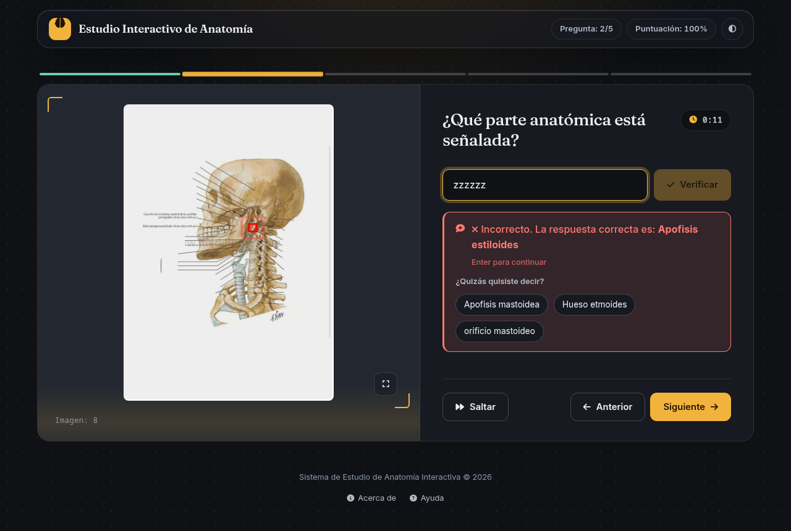
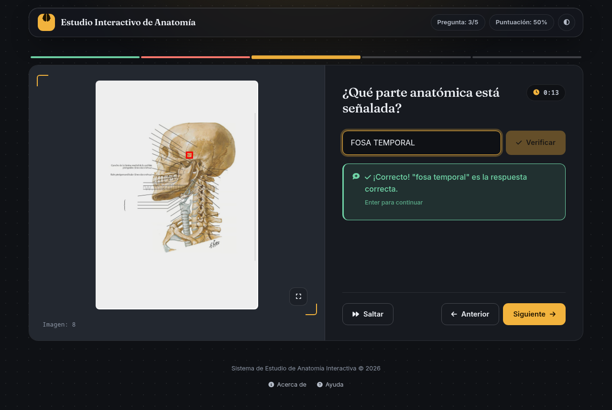
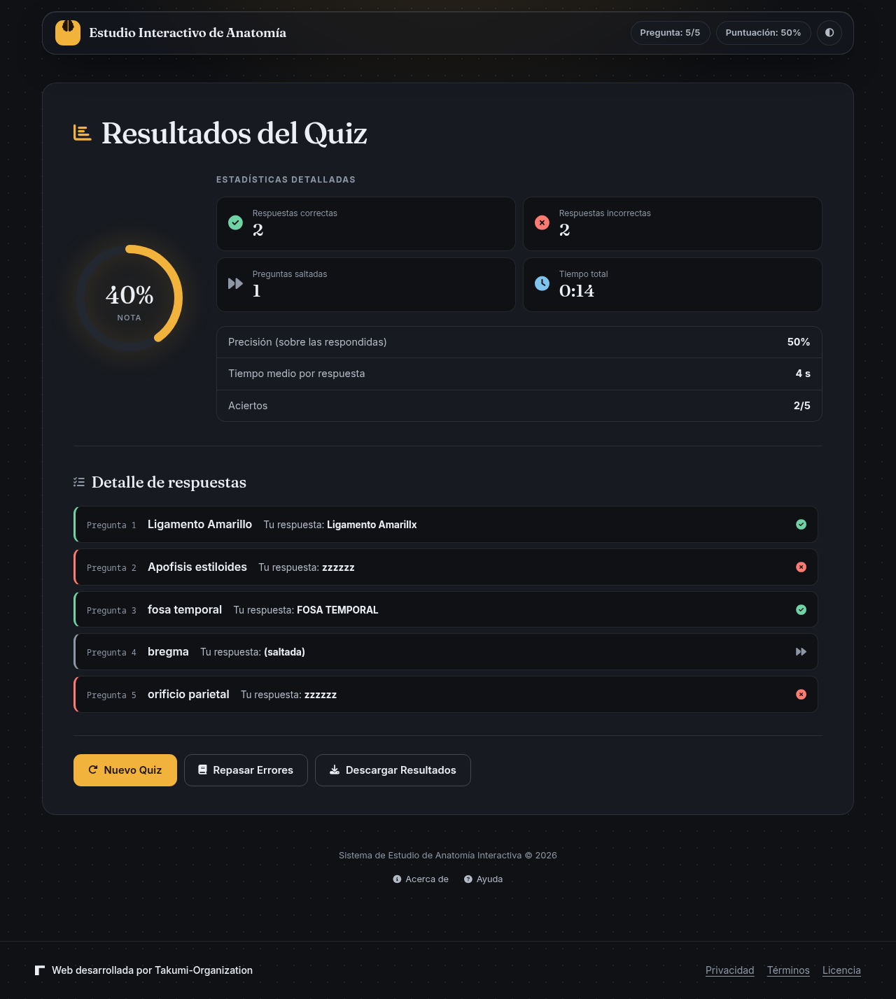

# Anatomy Page · Estudio interactivo de anatomía

Web de estudio para memorizar anatomía humana. Se muestra una lámina anatómica con un **recuadro rojo** sobre una estructura y hay que **escribir su nombre**. Es una página estática (HTML + CSS + JavaScript puro): no necesita servidor propio, base de datos ni dependencias que instalar.


## Qué hace

- Genera un cuestionario de 5 a 120 preguntas a partir de las láminas de `images/sin_nombres/`.
- Marca sobre la imagen la zona que hay que identificar (un `<canvas>` superpuesto dibuja el cuadro rojo).
- Corrige la respuesta ignorando mayúsculas, tildes y signos (`"Ángulo Esfenoidal"` = `"angulo esfenoidal"`).
- Si fallas, enseña la respuesta correcta y **hasta tres sugerencias** de nombres parecidos.
- Al terminar muestra nota, aciertos, fallos, saltadas, tiempo, preguntas por minuto y el detalle de cada respuesta.
- Guarda tu mejor nota, tu dominio por sistema y región y los errores pendientes en el navegador (`localStorage`); no se envía nada a ningún sitio. En el inicio, *Repasar errores acumulados* los retoma entre sesiones.
- Opción de corrección *Permitir 1 errata* (nombres de 5+ letras; cuenta como acierto y avisa con «¡Casi!»). Por defecto, exacta.
- Atajos: `Enter` verifica/continúa · `Alt`+`←`/`→` navegar · `Alt`+`S` saltar · `Alt`+`Z` ampliar · `Esc` cerrar.

## Cómo se usa

1. **Inicio**: elige número de preguntas y modo de estudio.
   - *Mezclado*: partes de cualquier lámina.
   - *Por sistemas*: elige al azar un sistema (esquelético o nervioso) y pregunta solo de ese.
   - *Por regiones*: lo mismo con una región (cabeza, columna, cuello).
2. **Pregunta**: escribe el nombre y pulsa *Verificar* o `Enter`; tras verificar, `Enter` (o *Siguiente*) continúa: no avanza solo. Con *Saltar* pasas sin responder; *Anterior* / *Siguiente* navegan. Pulsa la lámina (o `Alt`+`Z`) para ampliarla: rueda para acercar, arrastrar para mover, doble clic para restablecer. Una barra segmentada muestra tu avance por colores.

   

3. **Feedback**: acierto en verde; fallo en rojo con la solución y sugerencias.

   | Fallo con sugerencias | Acierto |
   |---|---|
   |  |  |

4. **Resultados** (*Nota* sobre el total, *Precisión* sobre las respondidas y tiempo medio por respuesta): nota en círculo, estadísticas, revisión pregunta a pregunta, *Repasar errores* y *Descargar resultados* (un fichero JSON con el detalle).

   

## Ejecutarlo

La app es un módulo ES y carga `data.json` con `fetch`, así que **no funciona abriendo `index.html` con doble clic** (`file://`); sirve la carpeta con cualquier servidor estático:

```bash
python3 -m http.server 8000
# abre http://localhost:8000
```

Los iconos vienen de Font Awesome 6.4 por CDN, así que hace falta conexión para verlos.

## Estructura

```
index.html          pantallas (inicio, quiz, resultados), lámina ampliada, modal «Acerca de», avisos y pie de marca
data.json           láminas y partes a preguntar (sin cambios)
images/
  sin_nombres/      láminas sin etiquetas: PNG originales y su versión .webp (≈ 8× más ligera, mismas dimensiones)
  con_nombres/      láminas con etiquetas (consulta; la app no las lee)
assets/             fuentes (Inter, Fraunces), iconos (Font Awesome) y three.js recortado (vendor/): la web no usa CDN
src/
  css/              tokens · base · splash · components · home · quiz · results · overlays · takumi-footer · responsive
  js/
    main.js         controlador: une modelo, almacenamiento y vista
    quiz.js         modelo (preguntas, respuestas, puntuación, erratas); sin DOM
    mastery.js      dominio acumulado por sistema/región y errores pendientes; sin DOM
    text.js         normalizar, similitud, formatos; sin DOM
    storage.js      localStorage con try/catch
    data.js         carga de data.json
    config.js       constantes y claves de localStorage
    ui/             dom, view, highlight (marcador), zoom, dialogs (avisos), effects, hero3d (escena del inicio), splash (bienvenida)
tests/              node --test tests/
LICENSE             MIT (código)
```

Bienvenida: al abrir la web (una vez por sesión; configurable en el inicio: siempre, una vez o desactivada, con botón *Ver*) aparece a pantalla completa con revelado circular, radar, el logo fijado por un retículo rojo, el título palabra a palabra y cifras reales (láminas, estructuras, mejor nota, errores por repasar). Se cierra sola o con clic/`Enter`/`Esc`/espacio, con una línea de escáner que enrolla la pantalla hacia arriba, y la escena 3D empieza a ensamblarse justo entonces. No sale con «reducir movimiento»; `?nosplash` en la URL la omite.

Inicio: escena 3D procedural (columna vertebral de 24 vértebras con escáner, señales nerviosas y un retículo que pregunta «¿qué estructura es?»; arrastra para girar, pasa el cursor por una vértebra para ver su nombre). Three.js se carga bajo demanda; sin WebGL o con «reducir movimiento» la página sigue funcionando (escena estática u oculta). Al pulsar *Iniciar Quiz* la cámara se sumerge en la columna.

Diseño: estilo editorial (serif para titulares, Inter, acento oro), claro/oscuro según el sistema con interruptor manual, cristal solo en cabecera y diálogos, y animaciones que se desactivan con «reducir movimiento».

Pruebas de la lógica: `node --test tests/` (no necesita instalar nada).

### Formato de `data.json`

```json
{
  "imagen": "images/sin_nombres/1.png",
  "sistema": "esqueletico",
  "region": "cabeza",
  "partes": [
    { "nombre": "Hueso Parietal", "x": 474, "y": 378, "width": 50, "height": 50 }
  ]
}
```

`x` e `y` son el **centro** del cuadro en píxeles de la imagen original; `drawHighlight` (`src/js/ui/highlight.js`) los escala al tamaño con el que se pinta la imagen. Un campo opcional `hint` se muestra como *Pista*.

Contenido actual: **19 láminas y 387 partes** (esquelético: cabeza 8, columna 5, cuello 2; nervioso: cabeza 4).

### Cómo funciona por dentro

- `buildQuestions()` aplana todas las partes, filtra según el modo, las baraja y toma las N primeras (como mucho, las que haya).
- `normalizeText()` (`text.js`) pasa a minúsculas, quita diacríticos (`NFD`) y signos y colapsa espacios. La respuesta es correcta si el texto normalizado es **idéntico**.
- `similarNames()` busca en todo el banco las partes cuyo nombre se parece al **correcto** (`getSimilarity()`, distancia de edición, umbral 0,4) y muestra las tres más parecidas, sin repetir: sirven para distinguir estructuras parecidas, no para corregir tu errata.
- Las estadísticas (`anatomyQuizStats`), el progreso y el aviso del tutorial se guardan en `localStorage`; el botón *Limpiar* del inicio lo borra.

## Para añadir contenido

1. Copia la lámina sin etiquetas a `images/sin_nombres/`.
2. Añade una entrada en `data.json` con cada parte y su recuadro (`x`, `y`, `width`, `height`).
3. Recarga la página: los contadores del inicio se actualizan solos.

## Limitaciones conocidas

- Por defecto la respuesta exige el nombre **exacto**; con *Permitir 1 errata* se admite un error de una letra en nombres de 5+ letras.
- *Siguiente* permite avanzar sin responder y esa pregunta no queda registrada.
- `data.json` aún no incluye `hint` en las partes, así que no aparece la *Pista* (se oculta si no hay).
- Los `.png` originales siguen en el repo junto a los `.webp` (la app usa el WebP y cae al PNG si faltara); las láminas pesan ~73 MB en PNG y ~9 MB en WebP.

## Tecnologías

HTML5, CSS3, JavaScript (módulos ES, sin frameworks ni compilación), Canvas, `localStorage`, Font Awesome.

## Licencia y políticas

- Código bajo licencia **MIT** (`LICENSE`), © 2026 Takumi-Organization. Las láminas de `images/` **no** están cubiertas: son material de terceros y sus derechos no están confirmados. Fuentes e iconos locales (`assets/`): Inter y Fraunces (SIL OFL 1.1) y Font Awesome Free 6.4.0 (iconos CC BY 4.0, fuentes OFL 1.1, código MIT) y three.js (MIT).
- Como toda web desarrollada por Takumi-Organization, lleva en el pie la marca «Web desarrollada por Takumi-Organization» con enlace a [takumi-organization.github.io](https://takumi-organization.github.io) y a su [privacidad](https://takumi-organization.github.io/privacidad/), [términos](https://takumi-organization.github.io/terminos/) y [licencias](https://takumi-organization.github.io/licencias/) (norma: [política de la entidad](https://takumi-organization.github.io/entidad/)).
- Esta app no usa cookies ni envía datos: el progreso y las preferencias se guardan solo en el `localStorage` de tu navegador.
